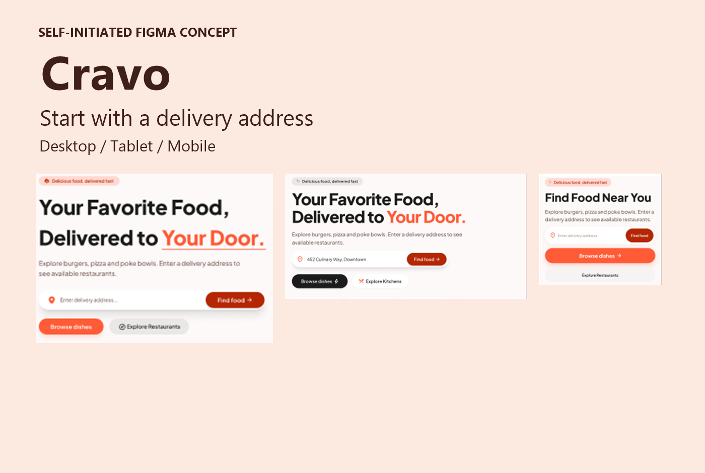
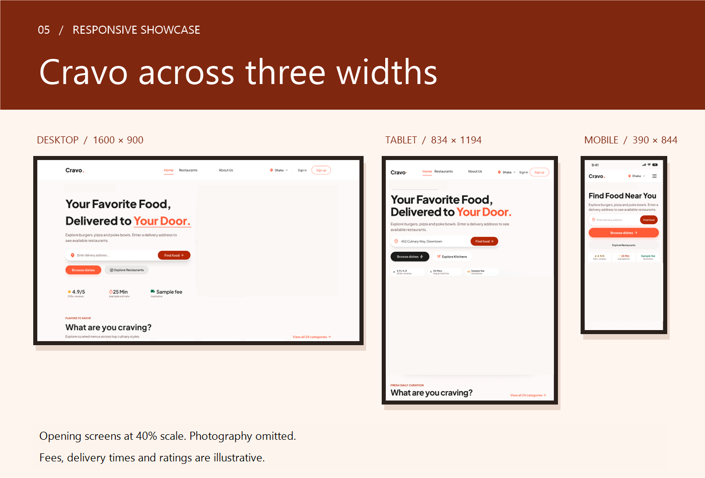

# Cravo | Responsive Food Discovery Website

A self-initiated UI/UX design concept by **Ahasanul Karim Khan**, created in Figma for desktop, tablet and mobile.

[View the full Cravo case study on Behance](https://www.behance.net/gallery/256962485/Cravo-Responsive-Food-Discovery-Website-UXUI-Concept)

## Overview

Cravo explores two ways to begin looking for food: entering a delivery address and browsing dishes. The homepage brings categories, restaurants and dishes into a responsive layout.

## My contribution

- Designed the homepage compositions in Figma.
- Organized address entry and dish browsing as separate starting actions.
- Adapted category browsing, restaurant cards and dish grids across three screen widths.
- Revised layouts following design review, including copy containment and mobile footer link sizing.

## Responsive preview

These are selected Figma presentation excerpts. Photography is omitted from this repository's previews. Addresses, ratings, delivery times and fees are illustrative. The frames show design compositions rather than a working service.

## Design decisions

| Decision | Intent |
| --- | --- |
| Separate address entry from browsing | Make the two starting choices visible without suggesting that delivery availability has already been checked. |
| Adapt category layouts by width | Preserve category discovery as the available horizontal space changes. |
| Stack restaurant cards on mobile | Give restaurant details a readable area within a narrow screen. |
| Use a two-column mobile dish grid | Keep individual dish browsing visually distinct from restaurant comparison. |
| Reserve room for restaurant ratings | Allow longer restaurant names to wrap without crowding the rating. This is a review requirement; final verification remains open. |

See [design notes](docs/design-decisions.md) for scope and evidence boundaries, and [asset notes](docs/assets.md) for the preview sources.

## Deliverable scope

Responsive Figma homepage compositions and documented design intent. This repository does not currently contain application code, a working address lookup, checkout or a deployed service.

This is a concept project. Restaurant names, ratings, prices, delivery estimates, fees and promotions are illustrative. No user-testing, launch or business-impact results are claimed.

## Designer

[Ahasanul Karim Khan on Behance](https://www.behance.net/ahasanulkarim1808) · [GitHub](https://github.com/ahasanulkarimkhan-uiux)

No open-source license is granted by this repository.
